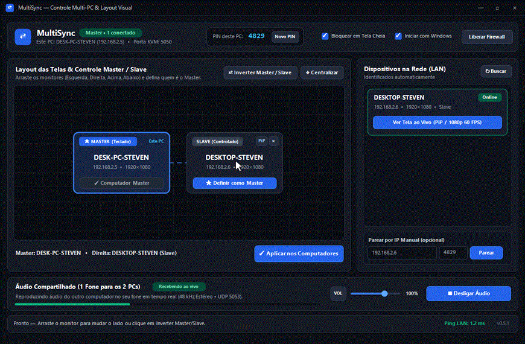
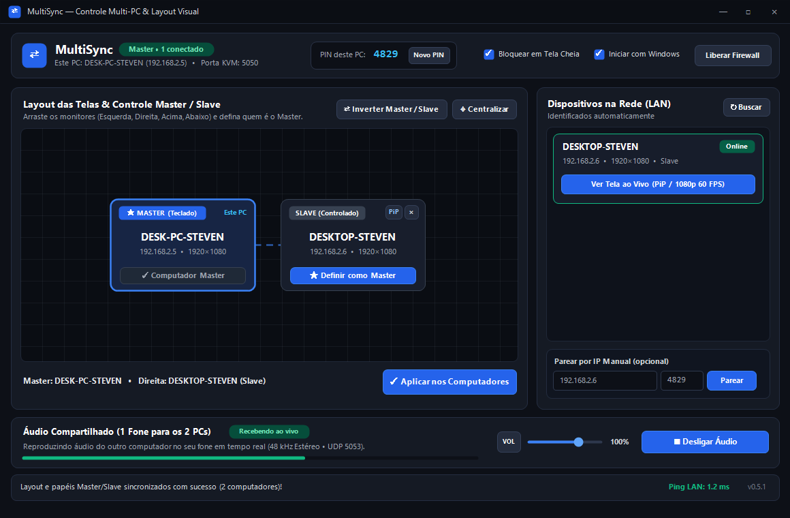
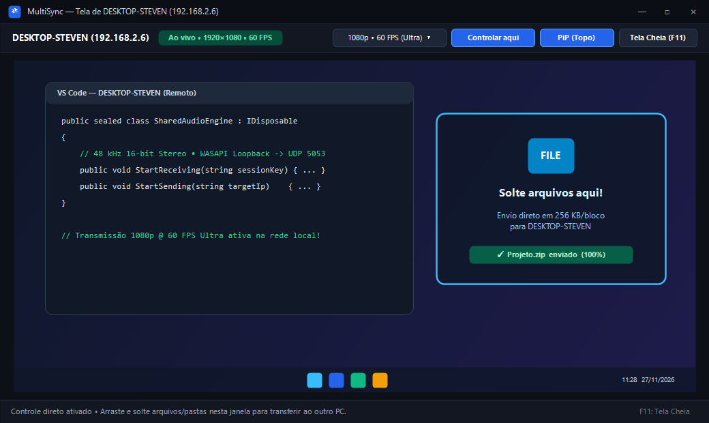
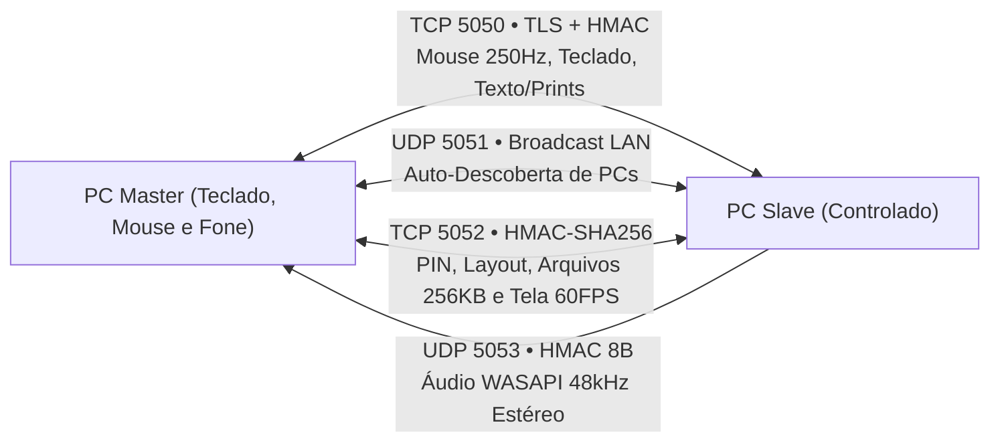

<div align="center">

# ⇄ MultiSync

**Plataforma Nativa de Integração Multi-PC de Baixa Latência**
*Um mouse, um teclado, um fone de ouvido, área de transferência universal, transferência de arquivos em alta velocidade e visualização de telas ao vivo (até 1080p 60 FPS) na sua rede local.*

[](https://dotnet.microsoft.com/)
[](#como-compilar)
[](#roadmap)
[](#)
[](#arquitetura-e-portas)

<br/>



</div>

---

## ✨ O que o MultiSync faz?

O **MultiSync** conecta dois ou mais computadores na mesma rede local (cabo ou Wi-Fi) em uma única estação de trabalho fluida, com executável único (`MultiSync.exe`) e interface escura nativa em WPF — sem navegador embutido, sem servidores na nuvem e sem contas obrigatórias.

| Recurso | Descrição | Status |
| :--- | :--- | :---: |
| **🖥️ Layout Visual Drag & Drop** | Arraste os monitores (Esquerda, Direita, Acima, Abaixo) e inverta **Master ↔ Slave** com 1 clique, sincronizando todos os PCs automaticamente. | ✅ Pronto |
| **📡 Descoberta Automática na LAN** | Detecta outros computadores na rede via broadcast UDP e faz pareamento seguro com **PIN de 4 dígitos** + assinatura HMAC-SHA256. | ✅ Pronto |
| **🖱️ KVM Ultra-Responsivo (250 Hz)** | Captura via **Raw Input (`WM_INPUT`)**, coalescência atômica a ≤ 250 Hz (zero lag com mouses 1000 Hz), entrada exata na borda e cursor estacionado na borda. | ✅ Pronto |
| **🛡️ Controle sobre UAC, Firewall e Admin** | Serviço de sistema dedicado (`MultiSyncInputHelper` em `WinSta0`) que mantém o controle total mesmo sobre janelas elevadas de Administrador, UAC e Tela de Bloqueio. | ✅ Pronto |
| **🎮 Bloqueio Inteligente em Jogos Tela Cheia** | Impede que o mouse escape acidentalmente para o outro PC durante jogos em Tela Cheia / Borderless (ex.: *League of Legends*), mantendo janelas normais livres. | ✅ Pronto |
| **📋 `Ctrl+C` / `Ctrl+V` Universal + Arquivos** | Sincronização bidirecional de texto, prints/imagens e **arquivos/pastas até 2 GB** via canal TCP dedicado de alta velocidade (`256 KB/bloco`) sem travar o mouse. | ✅ Pronto |
| **🎧 Áudio Compartilhado (1 Fone nos 2 PCs)** | Captura o áudio do outro PC via **WASAPI Loopback** e reproduz no seu fone em tempo real (`48 kHz Estéreo` via UDP `5053`), com controle de volume (0–150%) e mute. | ✅ Pronto |
| **🪟 Espelhamento de Tela (`Ver Tela / PiP`)** | Abra a tela do PC 2 dentro de uma janela no PC 1 (e vice-versa) com perfis até **`1080p • 60 FPS (Ultra)`**, modo **Sempre no Topo (PiP)**, **Tela Cheia (F11)** e **Controle Direto**. | ✅ Pronto |
| **📂 Arrastar e Soltar Arquivos na Tela Remota** | Arraste arquivos ou pastas e solte diretamente sobre a janela `Ver Tela (PiP)` para enviá-los ao outro computador em alta velocidade. | ✅ Pronto |
| **🐧 Suporte Cross-Platform para Linux** | Interoperabilidade completa Windows ↔ Linux (X11 / Wayland / `uinput` + PipeWire/PulseAudio). | 🚧 Próximo |

---

## 🖼️ Interface do MultiSync

### Painel Principal — Layout Drag & Drop, Rede Local e Áudio Compartilhado
Arraste os cards dos monitores para escolher a posição física da sua mesa, alterne quem é o **Master** com um clique, monitore o ping em tempo real e ative o **Áudio Compartilhado** na barra inferior:



### Janela `🖥️ Ver Tela (PiP)` — Até 1080p @ 60 FPS + Arrastar Arquivos
Assista e controle o outro computador em uma janela redimensionável (ou em Tela Cheia com `F11`), fixe no canto com **PiP (Topo)** e arraste arquivos diretamente para dentro da janela:



---

## ⚙️ Como Funciona (Arquitetura & Portas)

Toda a comunicação acontece **100% na rede local (LAN)** — nenhum dado sai para a internet.



| Porta | Protocolo | Função |
| :---: | :---: | :--- |
| **`5050`** | `TCP (TLS)` | Fluxo KVM interativo de baixíssima latência (mouse, teclado ABNT2/Unicode, scroll, texto e imagens do clipboard). |
| **`5051`** | `UDP` | Beacons de auto-descoberta de dispositivos MultiSync na rede local. |
| **`5052`** | `TCP` | Pareamento por PIN, sincronização de layout Master/Slave, controle de áudio, transferência dedicada de arquivos (`256 KB`) e streaming de tela ao vivo (até `1080p 60 FPS`). |
| **`5053`** | `UDP` | Streaming de áudio compartilhado em tempo real (`48 kHz 16-bit Estéreo`, pacotes de 10 ms autenticados por HMAC). |

> O MultiSync libera automaticamente essas 4 portas no Firewall do Windows ao iniciar (ou pelo botão **Liberar Firewall** no topo da interface).

---

## 🚀 Como Usar

1. **Abra o `MultiSync.exe`** nos dois computadores conectados na mesma rede local.
2. **Pareie via PIN:** na aba direita (*Dispositivos na Rede*), digite o **PIN de 4 dígitos** exibido no outro PC e clique em **Parear PIN**.
3. **Posicione as telas:** arraste os monitores no canvas central para o lado desejado (Esquerda, Direita, Acima ou Abaixo), escolha quem será o **Master** e clique em **✓ Aplicar nos Computadores**.
4. **Use os recursos integrados:**
   - **Mouse/Teclado:** deslize o mouse pela borda configurada para controlar o outro PC.
   - **Atalhos globais:** `Ctrl+Alt+Win+L` (travar/destravar na tela atual) • `Ctrl+Alt+Win+Setas` (pular direto de tela).
   - **Arquivos/Clipboard:** `Ctrl+C` em um PC e `Ctrl+V` no outro (funciona para texto, prints, arquivos e pastas até 2 GB).
   - **1 Fone nos 2 PCs:** no computador onde o fone está plugado, clique em **🎧 Ouvir outro PC neste fone**.
   - **Ver Tela do Outro PC:** clique em **🖥️ Ver Tela (PiP)** no card do computador conectado e escolha a qualidade desejada (até **1080p • 60 FPS Ultra**).

---

## 🛠️ Estrutura do Projeto

```text
MultiSync/
├── MultiSync.Core/
│   ├── Audio/          # SharedAudioEngine (WASAPI Loopback + UDP 5053)
│   ├── Clipboard/      # ClipboardSyncManager (STA OLE FileDrop + Win32)
│   ├── Discovery/      # LanDiscoveryAndControlService (UDP 5051 + TCP 5052)
│   ├── Models/         # ConfigStore, HMAC-SHA256 e modelos de topologia
│   ├── Network/        # KvmSessionEngine (TLS 250Hz + pacote único)
│   ├── ScreenShare/    # ScreenStreamEngine (captura otimizada até 1080p 60 FPS)
│   ├── Topology/       # TopologyCompiler (grafo direcional + coordenadas de borda)
│   └── Win32/          # Raw Input, Hooks LL, Fullscreen Guard e SystemInputService (WinSta0)
├── MultiSync.App/      # Interface WPF escura, RemoteScreenWindow (PiP) e System Tray
├── MultiSync.Tests/    # Testes automatizados (NUnit)
└── docs/assets/        # Imagens e GIF animado da interface
```

---

## 📦 Como Compilar (Windows)

Requisitos: **.NET 10 SDK** no Windows 10/11 (x64).

```powershell
# Rodar testes automatizados
dotnet test MultiSync.sln -c Release

# Gerar executável único (self-contained — não precisa de .NET instalado no PC de destino)
dotnet publish MultiSync.App\MultiSync.App.csproj -c Release -r win-x64 --self-contained true -p:PublishSingleFile=true -p:IncludeNativeLibrariesForSelfExtract=true -o publish
```

O executável final será gerado em `publish\MultiSync.exe`.

---

## 🗺️ Roadmap

- [x] Motor KVM nativo Win32 com Raw Input, 250 Hz coalescing, ABNT2 e serviço SYSTEM (`WinSta0` para UAC/Admin)
- [x] Proteção automática de borda para jogos em Tela Cheia / Borderless
- [x] Auto-descoberta na LAN + Pareamento seguro por PIN de 4 dígitos
- [x] Interface gráfica nativa WPF com Drag & Drop de telas e troca dinâmica Master ↔ Slave
- [x] `Ctrl+C` / `Ctrl+V` bidirecional (texto, imagens e transferência dedicada de arquivos até 2 GB)
- [x] Áudio compartilhado em tempo real (WASAPI Loopback → 1 fone para os 2 PCs)
- [x] Espelhamento de tela bidirecional (PiP, Tela Cheia, Controle Direto, `1080p 60 FPS Ultra` e Drag & Drop de arquivos)
- [ ] **Suporte completo para Linux (`MultiSync.Linux`)** com interoperabilidade total Windows ↔ Linux
